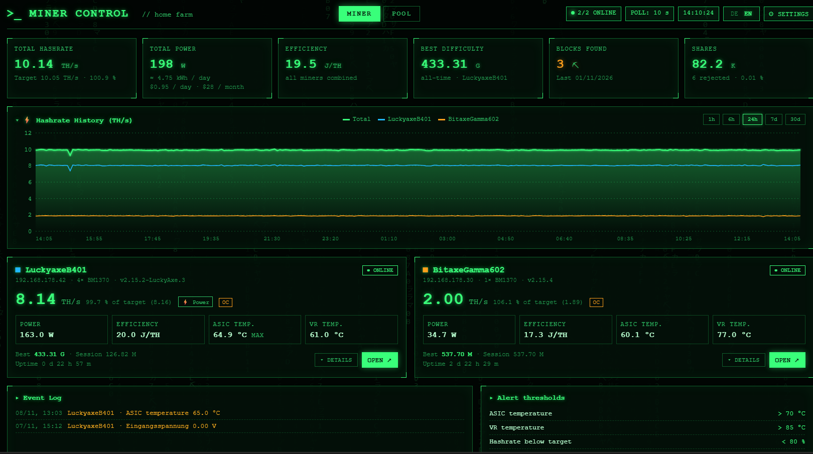
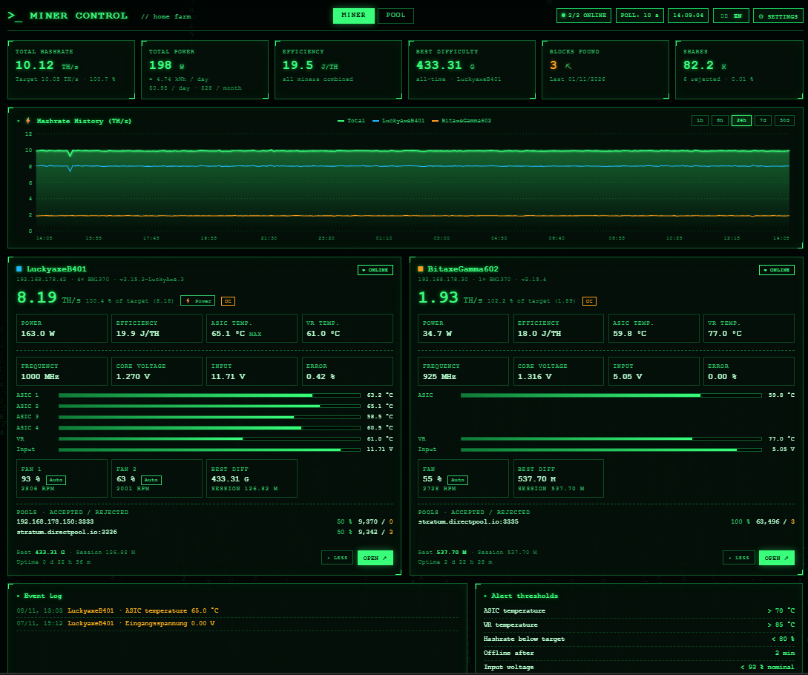
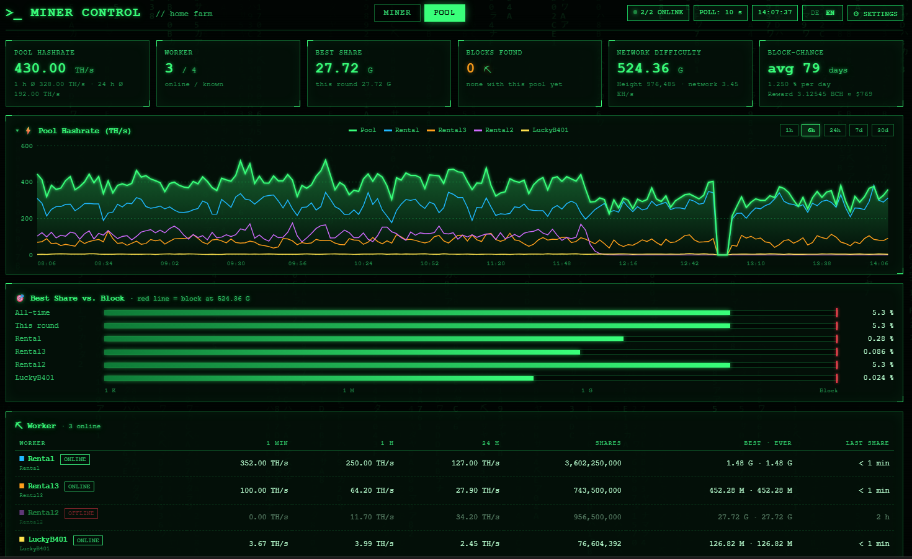
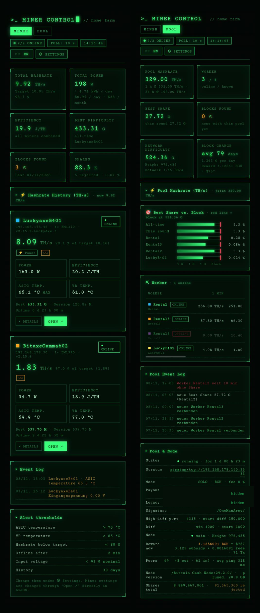
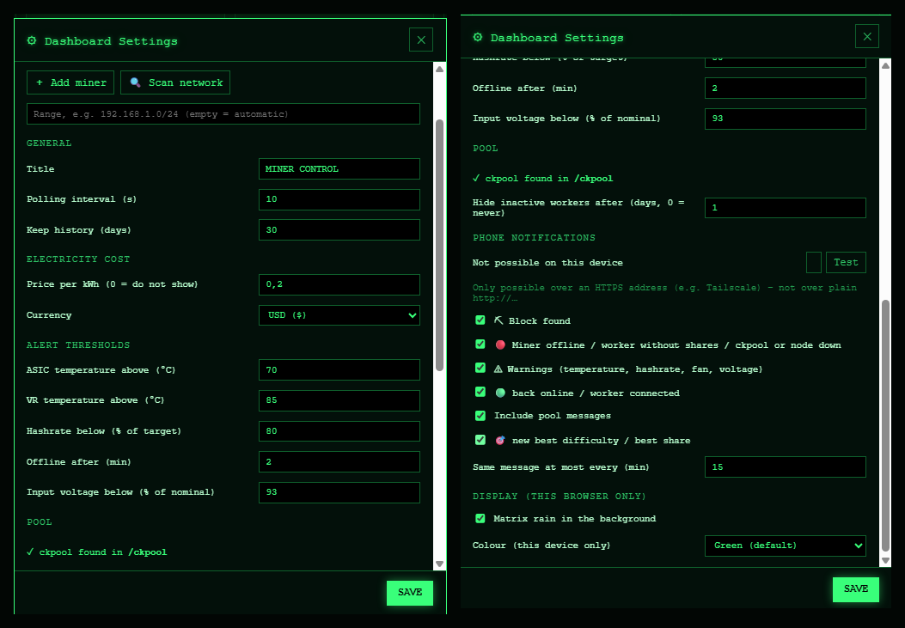
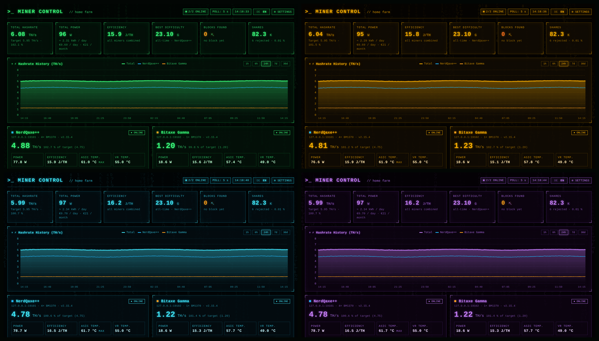
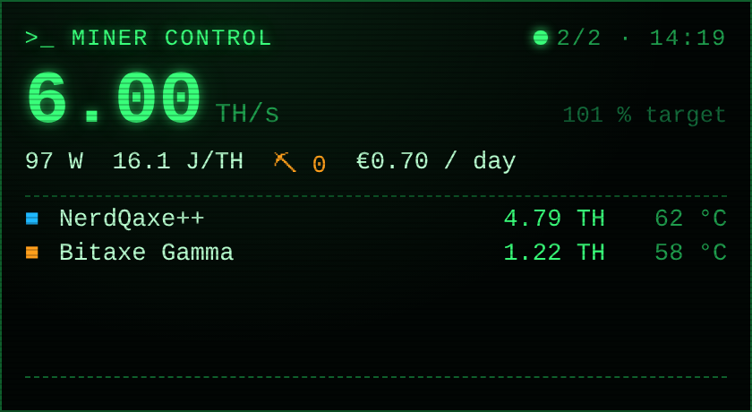

# >_ Miner Control

**A read-only dashboard for AxeOS miners (Bitaxe, NerdQaxe, LuckyAxe, …) and your own ckpool / BCH node.**
Matrix-green look, German and English, installable as a phone app with push notifications, and no external Node.js libraries at all.

> 🇩🇪 Deutsche Kurzbeschreibung weiter unten, ausführliche Anleitung in [`docs/Anleitung_DE.md`](docs/Anleitung_DE.md).

## Features

- **All miners on one page**: hashrate (vs. target), power, J/TH, ASIC and VR temperatures, fans, best difficulty, shares, uptime, pools. Cards fold out for details.
- **Hashrate history** (1 h to 30 days) for every miner and the total.
- **Alerts** for temperature, low hashrate, offline, low input voltage, overheat and stalled fans, with adjustable limits and an event log.
- **Push notifications** to your phone: block found, new best difficulty, miner offline / back online, warnings, ckpool or node down.
- **POOL page** for your own **ckpool** (solo): pool hashrate, workers, best share vs. block, block chance, current reward, node status. The page only appears when a ckpool is found.
- **Network scan** finds AxeOS miners in your local network.
- **Electricity cost** per day and month in EUR or USD.
- **Widget view** (`/widget`) for phone widgets or small screens.
- **German / English** switch, **4 colour themes**, matrix rain on/off.
- **Read-only**: it never changes anything on your miners. Miner settings are opened directly in AxeOS.
- Runs with **Docker**, **CasaOS / Portainer**, **Linux** (systemd) and **Windows**. Only Node.js 18+ is needed, no `npm install`.

## Screenshots

| Miner details | Pool page (ckpool) |
|---|---|
|  |  |

| Phone (installed as app) | Settings |
|---|---|
|  |  |

**Colour themes**: green, amber, cyan, purple

**Widget**

## Quick start

Download the newest release ZIP (or *Code → Download ZIP*) and unpack it. Then open `http://<server-ip>:18090`.

| Running on | How |
|---|---|
| **Docker** (Linux) | `cd docker && cp .env.example .env && docker compose up -d` |
| **CasaOS / Portainer** | copy the `app` folder to `/DATA/AppData/minerdash/app`, paste `casaos/docker-compose.yml` into a new stack |
| **Linux** without Docker | `./linux/start.sh`, or as a service: `sudo ./linux/install.sh` |
| **Windows** | install Node.js 18+, double-click `windows\start.bat` |

Add your miners under **Settings** (by IP, or use **Scan network**).

Full guide: [`docs/Guide_EN.md`](docs/Guide_EN.md) · [`docs/Anleitung_DE.md`](docs/Anleitung_DE.md)

## Folders

| Folder | Content |
|---|---|
| `app/` | the program (same for every platform) |
| `docker/` | Docker Compose with relative paths, optional Tailscale profile |
| `casaos/` | stack with absolute paths for CasaOS and the Portainer web editor |
| `linux/` | start script, systemd installer and unit |
| `windows/` | start script, autostart on/off |
| `docs/` | guides (DE/EN) and screenshots |

## Phone app and push notifications

The page can be installed as an app (PWA). Installing and push both need **HTTPS**. The easiest way is [Tailscale](https://tailscale.com) with `tailscale serve`, which keeps everything inside your private network. See the guide, chapter Tailscale.

- **Android** (Chrome): tested.
- **iPhone** (iOS 16.4+, installed through Safari): **not tested**, see guide chapter 14.

## ckpool and other pools

The MINER page works with **any pool**, because the data comes straight from the miners. The POOL page reads a local **ckpool** folder (read-only) and asks your node through the RPC login in `ckpool.conf`. Other pool software is not supported there. How to set your ckpool path: guide chapter 15.

## Security

- The settings have **no password**. Run it only in your home network or inside a VPN such as Tailscale.
- **Never** expose it to the internet: use `tailscale serve`, **not** `tailscale funnel`, and no port forwarding.
- The dashboard only reads: AxeOS `/api/system/info`, ckpool files, read-only node RPC calls and a public coin price.

## Not tested yet

Windows autostart, the systemd service on a real system, the Docker Tailscale profile, iPhone push. Feedback is welcome.

---

## 🇩🇪 Kurz auf Deutsch

**Miner Control** ist ein Dashboard nur zum Anschauen für AxeOS-Miner (Bitaxe, NerdQaxe, LuckyAxe, …) und einen eigenen ckpool / BCH-Node. Es zeigt alle Miner auf einer Seite mit Verlauf, Warnungen, Push-Meldungen aufs Handy, Stromkosten, Netzwerk-Scan, Widget, Deutsch/Englisch und vier Farben. Es läuft mit Docker, CasaOS/Portainer, Linux und Windows und braucht nur Node.js 18+.

- Anleitung: [`docs/Anleitung_DE.md`](docs/Anleitung_DE.md)
- Die Einstellungen haben **kein Passwort**: nur im Heimnetz oder per Tailscale (`serve`, nicht `funnel`) nutzen, nie ins Internet stellen.
- Die Seite POOL gibt es nur mit eigenem ckpool. Die Seite MINER funktioniert mit jedem Pool.

## License

Copyright (C) 2026 Miner Control contributors

This program is free software: you can redistribute it and/or modify it under the terms of the **GNU General Public License** as published by the Free Software Foundation, either **version 3** of the License, or (at your option) any later version. It is distributed in the hope that it will be useful, but **without any warranty**. See [`LICENSE`](LICENSE).

Not affiliated with Bitaxe, AxeOS, ckpool or Tailscale.
